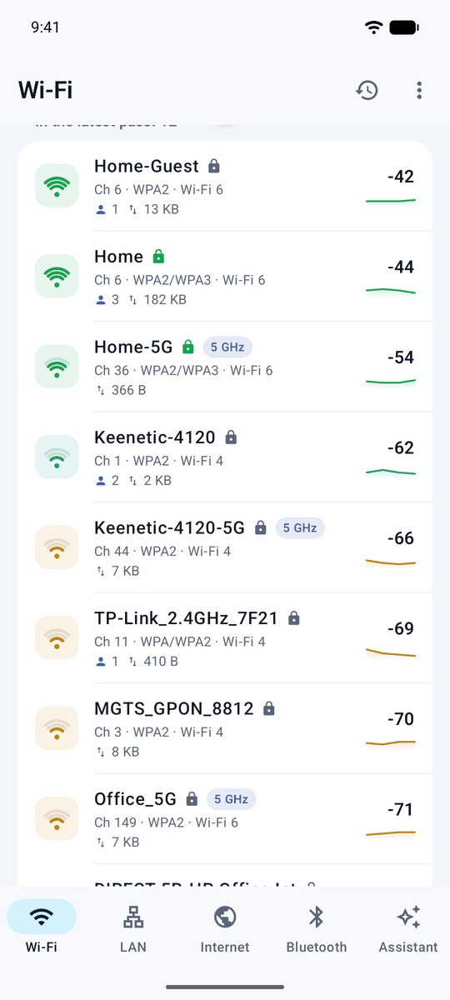
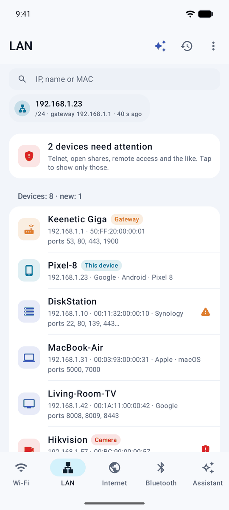
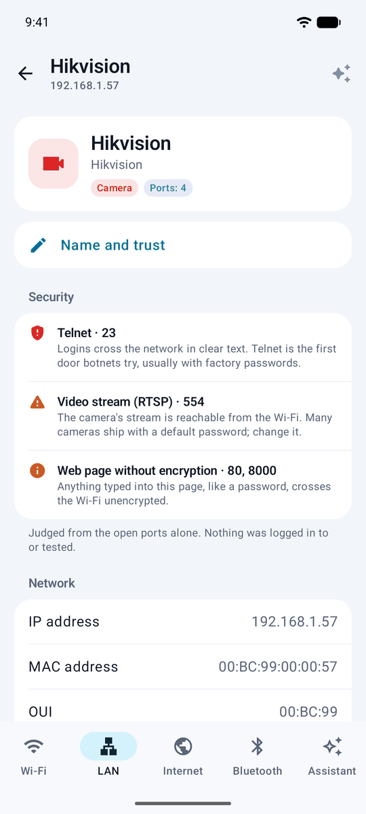
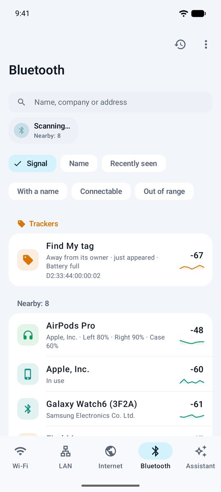

<p align="center">
  
</p>

<h1 align="center">Spectra</h1>

<p align="center">
  An audit of your own wireless surroundings: Wi‑Fi, the local network,<br>
  Bluetooth and the internet connection. Android and iPhone, with an optional ESP32 sensor.
</p>

<p align="center">
  <a href="../../releases/latest"></a>
  <a href="../../actions/workflows/ci.yml"></a>
  
  <a href="LICENSE"></a>
</p>

<p align="center">
  
  &nbsp;
  
  &nbsp;
  
  &nbsp;
  
</p>

<p align="center"><sub>Screenshots use made-up demo data (<a href="docs/screenshots.md">how they are made</a>).</sub></p>

Spectra shows what is around you and what it says about your security, in
plain words. Nothing is sent to a server: scans, history and the on-device
assistant (llama.cpp) all stay on the phone. The one exception is opt-in: with
web search turned on, the assistant sends a short query (a device's maker and
model, never an address or a name) to the search service you pick.

## What it does

- **Wi‑Fi.** Networks with channel, security, Wi‑Fi generation, signal over
  time and the clients on them. With the sensor: deauthentication attacks,
  hidden networks, a device that keeps sending like a camera or a microphone
  (named by its maker and address), and phones probing for networks they joined
  before. On Android the phone joins a network through the system's own "save
  network" sheet. **Saved networks** keeps the passwords that worked (they go
  to the sensor too).
- **LAN.** Every device on your network, its maker, open ports and what they
  mean: Telnet, open shares, camera streams, unencrypted web pages, UPnP port
  forwarding on the router. Smart-home appliances that open no TCP port at all,
  such as Xiaomi Mi Home devices, are found by their own UDP hello. A device
  new to the network gets a notification. The web pages of your own devices can
  be kept in a list that opens them with a tap.
- **Internet.** A connection check, a link checker for phishing and look-alike
  names, a speed test and traceroute on a map. Wi‑Fi, the mobile network and a
  VPN are measured apart; when a VPN lets no app around it, the Android app
  says so instead of passing the VPN off as Wi‑Fi.
- **Traffic.** A recording of the phone's own traffic, like Charles on the
  phone: HTTP/1.1, HTTP/2 and WebSocket, bodies of any type with JSON coloured
  and searchable, timing and sizes. Requests as a list or grouped by endpoint,
  filters by method, errors and protocol, repeat and edit, Map Local,
  throttling, HAR and cURL export, and a list of hosts to decrypt. HTTPS is
  read only after you install the app's own certificate; pinned apps pass
  through unread. ([More](#recording-traffic))
- **Bluetooth.** Nearby devices with their names, makers and signal, and
  trackers (Find My, Tile, SmartTag, Chipolo, Pebblebee) that may be following
  you.
- **Assistant.** A language model on the phone that explains a scan
  (Android 12+, downloaded once). ✨ on a screen opens a summary card: the
  findings at once, the model's plain words under them, and buttons for the
  next check. **More detail** and **Deep analysis** can also search the web for
  the device's model and known problems and show its photo, with the sources
  listed. In recorded traffic ✨ works on the whole recording, an endpoint, a
  request and a connection. Summaries are filed in folders.
- **History.** Finished scans are kept per network and day; the clock on each
  tab opens that tab's own history, and a session opens onto its records. A
  saved network, host or Bluetooth device opens the same card as a live one,
  and "first seen" is the earliest date in all of History.

iOS does not let apps list nearby networks, so on iPhone the Wi-Fi list comes
from the sensor: an M5Stack Cardputer (ESP32-S3), an ESP32-C5 or an
ESP32-WROOM-32 scans and sends every access point it hears to the app over
Bluetooth LE. Android can also scan with the phone's own radio.

```
android/    Android app (Kotlin, Jetpack Compose) and the llama.cpp engine module
ios/        Xcode project for the iPhone app and its packet-tunnel extension
firmware/   PlatformIO project for the sensor (Cardputer, ESP32-C5, WROOM-32)
docs/       BLE protocol between the apps and the sensor
data/       Catalogs shared by both apps (MAC vendors, Bluetooth IDs, RDAP) and their build scripts
```

> **Use it on networks and devices you own or are allowed to test.** Spectra
> is a defensive tool. It listens; it does not attack. Some features (raw
> 802.11 frame capture to `.pcap`, decrypting your own phone's TLS traffic,
> port scans of the local network) can reveal other people's data if pointed
> at a network that is not yours. Capturing or inspecting traffic you are not
> authorised to see is illegal in many countries. See [SECURITY.md](SECURITY.md).

## Download

Get the APK (arm64 phones) and the sensor firmware for all three boards from
[**Releases**](../../releases/latest), with checksums and build attestations.
How they are built and how to check them: [docs/releasing.md](docs/releasing.md).

The APK is signed with a certificate whose SHA-256 fingerprint is

```
D3:AD:5E:D1:B3:95:EB:0E:1C:0F:0A:47:DB:29:B6:A0:ED:29:95:69:EC:C9:AC:85:C8:63:B1:C0:C4:4F:F0:7E
```

(`apksigner verify --print-certs` prints it as `d3ad5ed1b395eb0e1c0f0a47db29b6a0ed299569ecc9ac85c863b1c0c44ff07e`.)
An APK with any other signature was not built by this project.

## Quick start

| Part | Needs | Build |
|------|-------|-------|
| Android | Android Studio, JDK 17+, Android SDK 36, NDK 29 | `android/scripts/fetch-llama.sh`, then `cd android && ./gradlew :app:assembleDebug` |
| iOS | Xcode 26, iOS 18 device or simulator | `ios/Tools/build-llama.sh` once (~15 min), copy `ios/Config/Signing.local.xcconfig.example` to `Signing.local.xcconfig`, open `ios/Spectra.xcodeproj` |
| Sensor | [PlatformIO](https://platformio.org) | `cd firmware && pio run -t upload` |

`android/local.properties` (with `sdk.dir=...`) and
`ios/Config/Signing.local.xcconfig` are per-machine and git-ignored. The
assistant's language models are downloaded by the app on first use; they are
not part of this repository.

Tests: `./gradlew :app:testDebugUnitTest` in `android/`, the `Spectra` scheme
in Xcode, and `pio test -e native` in `firmware/`.

A fork has to use its own identifiers: `SPECTRA_BUNDLE_ID` in
`Signing.local.xcconfig`, plus the app group (`group.cattivole.Spectra` in
both `.entitlements` files and in `TrafficSniffer.swift` /
`PacketTunnelProvider.swift`) and the tunnel's bundle id in the Xcode project.
The packet tunnel needs the paid Network Extensions capability; everything
else runs with a free developer account.

## Firmware

```sh
cd firmware
pio run -t upload
```

Headless boards have no screen and no keyboard. The phone starts scans over
Bluetooth. Flash them with their own environment (4 MB flash, two app slots):

```sh
pio run -e esp32-c5-n4 -t upload          # ESP32-C5 N4, 2.4 and 5 GHz
pio run -e esp32-wroom32-ch340 -t upload  # ESP32-WROOM-32, CH340 USB serial
```

The C5 dev board uses its USB-Serial/JTAG port. The WROOM-32 board uses the
CH340 UART; if the upload never starts, set `upload_speed = 115200` for that
environment. These builds report no battery and no LoRa cap. Rebuild the
Android app after `pio run` and **Flash over USB** on the Sensor tab writes
the image that matches the chip: Cardputer, ESP32-C5 or WROOM-32. A blank
chip is already in the ROM bootloader. Later images can also arrive over
Bluetooth.

Or install through Launcher: copy `firmware/.pio/build/m5stack-cardputer-adv/firmware.bin`
(after `pio run`, also saved as `firmware/Spectra.bin`) to the SD card and
choose **SD** → file → **Install**. Use the app image, not a merged one with
bootloader and partitions, or it overwrites Launcher.

The Cardputer advertises as `M5Cardputer` (older firmware as `Spectra-XXXX`).
Its screen shows the link state and the strongest networks. Fn and the horizontal arrows move between Wi-Fi,
LAN, BLE, LoRa and Join; the vertical arrows scroll the list. **Enter** scans.
It works on its own: scans are saved to flash with the side button and uploaded
the next time a phone connects. **Join** picks a network and shows the password
in the clear; nothing connects until Enter confirms it. The credentials are
remembered so the password comes back next time. A LAN scan walks the link
only while it is already up.

Firmware 0.6.0 and newer can also be installed from the Sensor tab: **Update
firmware**, then pick `firmware.bin` from `pio run` — the same app image
Launcher takes, not a merged one. The phone sends it over Bluetooth; the
Cardputer checks the image and reboots into it. A blank chip, or older
firmware, has to be flashed once before that works. On Android, **Flash over
USB** on the Sensor tab writes the bootloader, partition table and app from
the phone: a blank ESP32-S3 is already in the ROM bootloader, and a chip that
is running something else needs G0 held while reset is tapped. A computer
(`pio run -t upload`) or the SD-card launcher still work. The partition
table (`default_8MB.csv`) has two app slots, which is what makes the later
Bluetooth swap possible.

The ESP32-S3 hears 2.4 GHz only. An ESP32-C5 also hears 5 GHz. A WROOM-32
hears 2.4 GHz only.

A Cap LoRa-1262 on the Cardputer-Adv EXT header adds two more radios. Its
GNSS fix is kept with any scan the side button stores, so a walk without
the phone still has a position when the capture is uploaded. **LoRa** on
the device, or **Scan LoRa** in the app, listens across the EU868 and RU864
channels and lists the transmitters it hears. The cap is optional; without it the
LoRa list says `No LoRa cap` and the app hides the section. A crosshair in the
header means the cap's GNSS is present (green when it has a fix), and an
antenna means the LoRa radio answered.

## iOS app

Copy `ios/Config/Signing.local.xcconfig.example` to
`ios/Config/Signing.local.xcconfig`, set your team, open
`ios/Spectra.xcodeproj` and run. Requires iOS 18.

The iPhone app has the Android app's version and the same tabs: Wi‑Fi, LAN,
Internet, Bluetooth and Assistant with its summary cards. What iOS does
not allow is left out: the phone's own Wi-Fi scan, flashing the sensor over
USB, and a broadcast miIO hello (the iPhone asks each address in turn). The
assistant and the whole app can be locked with Face ID. If the matching
`firmware/.pio/build/` directory is present, the build embeds each board's
`firmware.bin` for updating the sensor over Bluetooth; a git worktree takes
them from the main checkout.

iOS does not report local network access directly, so a LAN scan first
publishes and browses for a throwaway Bonjour service, `_spectra._tcp`, and
waits for the answer to the system prompt: until it is answered every packet
to the subnet is dropped. If access was turned off, the LAN tab links to
Settings. Addresses that stayed quiet in the first TCP pass are asked once
more, because a cold ARP cache does not finish within the 1.5 s timeout.

On the Sensor screen (the sensor capsule on the Wi‑Fi tab), **Find sensor**
lists Cardputers in range; the app reconnects to the last one by itself. The **Demo sensor** switch feeds made-up
networks through the same protocol, so the app can be worked on without the
hardware; in the simulator, which has no Bluetooth, it turns on by itself.

The Bluetooth tab listens from the iPhone itself, with CoreBluetooth. It
lists nearby Bluetooth Low Energy devices — name, signal, company, services
and the Apple messages they broadcast (AirPods, Find My, HomeKit). iOS does
not reveal the hardware address, and it does not hear classic Bluetooth.

## Android app

```sh
cd android
./gradlew :app:assembleDebug
```

Open `android/` in Android Studio. Requires Android 8 or newer. The package
id is `cattivole.spectra`.

If the matching `firmware/.pio/build/` directory is present, the Android build
packs `bootloader.bin`, `partitions.bin`, `boot_app0.bin` and `firmware.bin`
for the Cardputer, the ESP32-C5 and the WROOM-32. **Flash over USB** on the
Sensor tab asks the chip which it is and writes that image. The bootloader
sits at `0` on the S3, `0x2000` on the C5 and `0x1000` on the WROOM-32. The
same zip can be picked by hand: `flash.json` names the chip and lists each
file with its offset.

The phone radio is a second source of networks, which iOS does not allow.
It hears 5 GHz and 6 GHz (the Cardputer is 2.4 GHz only) and it is throttled
by the system to a few scans per two minutes. A BSSID the sensor still sees
keeps the sensor's record: clients, ciphers, the 40 MHz side, probes and
deauth frames are not in a phone scan. On Android 13 and newer the app asks
for nearby Wi-Fi and Bluetooth without turning those scans into location;
older releases still need fine location, and location services have to be on
or the scan comes back empty.

The Bluetooth tab shows the hardware address and whether it is public or
random. Classic inquiry is a separate switch: on many controllers it pauses
low-energy scanning until it finishes. The GATT link asks for a larger ATT
MTU itself (iOS does that automatically) and reconnects to the last sensor
by its address.

Saved scans keep the records themselves, so a network, host or Bluetooth
device opens the same card from History. The interface follows the system
language (English or Russian); strings live in
`android/app/src/main/resources/spectra/strings-ru.tsv`, keyed by the English text.

The LAN tab reads `/proc/net/arp`, so neighbour hardware addresses are
usually visible, and it walks the joined Wi-Fi or Ethernet subnet. A prefix
wider than /20 is limited to the local /24. There is no raw ICMP, so a host
counts as present when a TCP connect opens or is refused, ARP already has it,
or it answers the miIO hello on UDP 54321 (Xiaomi Mi Home appliances). Their
model is read from an `_miio._udp` mDNS name when the device announces one.

### Assistant and the web

Web search is off by default (Assistant → ⋮ → Internet). It works with
SearXNG (your own server, no key) or a service with your own API key:
Brave Search, Tavily, Exa, Firecrawl, You.com or Serper (Google). Keys are
kept encrypted on the phone. Tavily, Exa, Firecrawl and You.com read the
pages themselves, so the sites see the service rather than the phone; Brave,
Serper and SearXNG return links that the phone then reads. Each query can be
shown for approval before it goes out. **Searches** lists every query sent and,
for a day, what it found: a similar query is answered from there. On a summary
card only the device's maker and model (or a link's domain) is searched: never
an IP or MAC address, a network name or a name someone gave their device.
Nothing from recorded traffic is searched for.

Spectra and Probe Lab, its App Store sibling, share one icon design: Spectra's
has an amber beam and red pixels, Probe Lab's is all cyan.

## Recording traffic

Internet → **Traffic** sends the phone's own traffic through a local VPN
(a packet tunnel on iOS, `VpnService` on Android); the recording stays on it.
Without a certificate it lists the connections: site, protocol, size. To read
HTTPS, turn on **Decrypt TLS**, export the certificate the app made for this
phone and trust it:

- **iPhone:** install the profile in Settings, then turn it on in General →
  About → Certificate Trust Settings.
- **Android:** install it as a CA certificate in the security settings. Only
  apps that trust user certificates can be read: Chrome does, most apps do not.

An app that pins its certificate refuses it: such a connection goes through
unread and is marked. **Hosts to decrypt** narrows decryption to some hosts or
leaves some out. On iPhone the origin's certificate is not checked while a
connection is decrypted, so do not decrypt what you would not want intercepted.
Android checks it.

**Requests** can be grouped by endpoint: method, server and path, with numbers,
UUIDs and long tokens in the path shown as `{id}`. A body opens full screen,
with a search over all of it. The ✨ summaries look for passwords, tokens and
keys, unencrypted HTTP, errors, slow answers, needless repeats and weak
cookies. They name the kind and place of a secret, never its value. An ordinary
word in a path, such as a user name, is not recognised as private and is shown.

## Protocol

See [docs/protocol.md](docs/protocol.md). The app's `SensorProtocol` and the
firmware's `main.cpp` both implement it; the tests in `ios/SpectraTests`
check the app against byte layouts written out from the document.

## Security, contributing, licenses

- Reporting a vulnerability, and what Spectra is not for: [SECURITY.md](SECURITY.md).
- Patches and issues: [CONTRIBUTING.md](CONTRIBUTING.md).
- Third-party code, data and the downloadable models:
  [THIRD_PARTY_LICENSES.md](THIRD_PARTY_LICENSES.md).
- License: [MIT](LICENSE). Third-party components keep their own licenses;
  a binary you build and ship has to carry their notices too.
